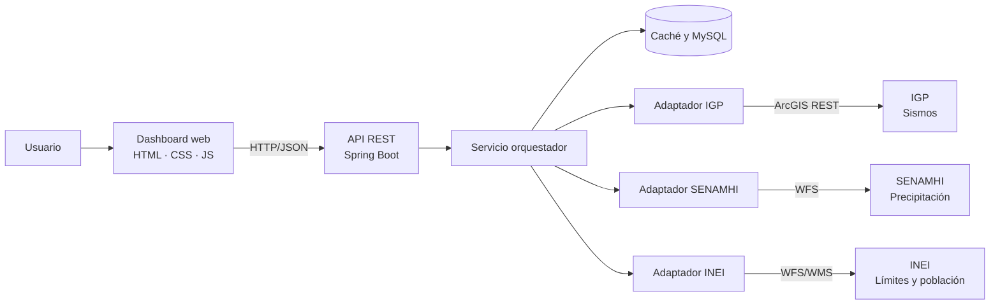

# GeoSOA

Sistema web para el monitoreo y análisis de riesgos naturales en el Perú mediante Arquitectura Orientada a Servicios (SOA).

GeoSOA integra en un solo dashboard la actividad sísmica del **IGP**, la información de precipitación del **SENAMHI** y los límites territoriales y datos demográficos del **INEI**, para relacionar cada evento con su ubicación, las condiciones de la zona y la población expuesta.

## Problema

Por su ubicación en el Cinturón de Fuego del Pacífico y la geografía de los Andes, el Perú convive con sismos, lluvias torrenciales, huaicos e inundaciones. Los datos del IGP, SENAMHI e INEI están dispersos en plataformas independientes, lo que obliga a revisar varias fuentes por separado, retrasa la toma de decisiones y dificulta evaluar el impacto real en la población.

## Objetivos

**General:** diseñar e implementar una plataforma web basada en SOA que integre y procese datos abiertos del IGP, SENAMHI e INEI para visualizar eventos naturales y su ubicación territorial mediante un dashboard interactivo.

**Específicos:**

- Desarrollar adaptadores para consumir los servicios web del IGP, SENAMHI e INEI en formatos JSON/XML.
- Diseñar un servicio orquestador que relacione la información sísmica con la precipitación y la densidad demográfica.
- Implementar resiliencia y tolerancia a fallos mediante caché ante caídas de las APIs del Estado.
- Construir un dashboard responsivo con mapas georreferenciados, consultas e indicadores.

## Alcance y limitaciones

- Cobertura: territorio peruano.
- Usuarios: ciudadanos, gestores de riesgo y autoridades.
- Depende de la disponibilidad de las fuentes oficiales; ante caídas sirve los últimos datos almacenados.
- No genera alertas propias ni reemplaza los comunicados oficiales.

## Arquitectura



1. El dashboard solicita información al backend.
2. El orquestador coordina las consultas a los servicios públicos mediante adaptadores.
3. Cada adaptador transforma la respuesta de su fuente a un formato común.
4. El orquestador relaciona el sismo con el distrito, la precipitación y la población de la zona.
5. Los datos consolidados se devuelven en JSON y se guardan en caché para tolerar caídas.

## Tecnologías

| Componente | Tecnología |
|---|---|
| Backend | Java 21, Spring Boot 4.1, Maven |
| Frontend | HTML, CSS, JavaScript, Leaflet, Chart.js |
| Base de datos | MySQL 8.4 |
| Servicios internos | REST sobre HTTP/HTTPS, JSON |
| Servicio sísmico | ArcGIS REST (IGP) |
| Servicio meteorológico | OGC WFS (SENAMHI) |
| Servicios territoriales | OGC WFS y WMS (INEI) |

## Estructura del repositorio

```
geosoa
├── backend       API REST (Spring Boot)
├── frontend      Dashboard web
├── docs          Documentación del proyecto
└── compose.yaml  Base de datos MySQL
```

## Ejecución local

**Requisitos:** Java 21, Docker.

```bash
# Base de datos
docker compose up -d

# Backend
cd backend
./mvnw spring-boot:run
```

| Servicio | Valor |
|---|---|
| MySQL | `localhost:3306`, base `geosoa`, usuario `soauser` |
| Backend | `http://localhost:8080` |

## Documentación

- [Plan de implementación del backend](docs/plan-backend.md)
- [Plan de implementación del frontend](docs/plan-frontend.md)
- [Servicios externos (IGP, SENAMHI, INEI)](docs/servicios-externos.md)
- [Endpoints del sistema](docs/endpoints.md)
- [Informe del proyecto](docs/informe.docx)

## Equipo

Curso de Arquitectura Orientada al Servicio – Ingeniería de Sistemas e Informática, 2026.

- Encalada Perez Antony Frank
- Rodriguez Nolasco Jannely Rosario
- Barrios Delgado Marco Antonio
- Castañeda Inocencio Rosalia Hillary
- Llatas Bernales Enzo Braian

Docente: Elmer Ely Medina Rodriguez
