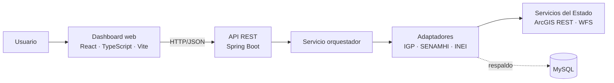
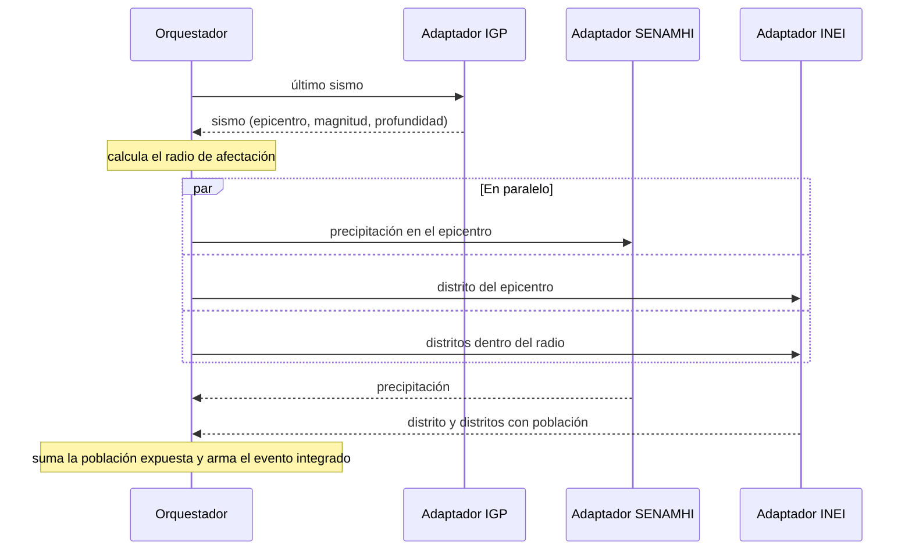
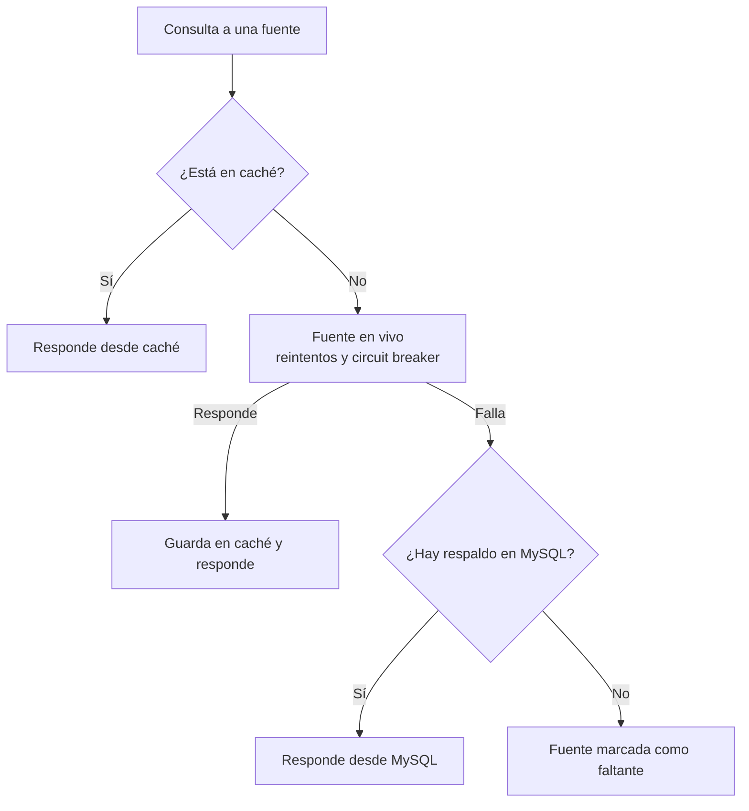

# GeoSOA

Sistema web para el monitoreo y análisis de riesgos naturales en el Perú mediante Arquitectura Orientada a Servicios (SOA).

GeoSOA integra en un solo dashboard la actividad sísmica del **IGP**, la información de precipitación del **SENAMHI** y los límites territoriales y datos demográficos del **INEI**, para relacionar cada evento con su ubicación, las condiciones de la zona y la población expuesta.

## Problema

Por su ubicación en el Cinturón de Fuego del Pacífico y la geografía de los Andes, el Perú convive con sismos, lluvias torrenciales, huaicos e inundaciones. Los datos del IGP, SENAMHI e INEI están dispersos en plataformas independientes, lo que obliga a revisar varias fuentes por separado, retrasa la toma de decisiones y dificulta evaluar el impacto real en la población.

## Objetivos

**General:** diseñar e implementar una plataforma web basada en SOA que integre y procese datos abiertos del IGP, SENAMHI e INEI para visualizar eventos naturales y su ubicación territorial mediante un dashboard interactivo.

**Específicos:**

- Desarrollar adaptadores para consumir los servicios web del IGP, SENAMHI e INEI en formatos JSON/XML.
- Diseñar un servicio orquestador que relacione la información sísmica con la precipitación y la densidad demográfica.
- Implementar resiliencia y tolerancia a fallos mediante caché ante caídas de las APIs del Estado.
- Construir un dashboard responsivo con mapas georreferenciados, consultas e indicadores.

## Alcance y limitaciones

- Cobertura: territorio peruano.
- Usuarios: ciudadanos, gestores de riesgo y autoridades.
- Depende de la disponibilidad de las fuentes oficiales; ante caídas sirve los últimos datos almacenados.
- No genera alertas propias ni reemplaza los comunicados oficiales.

## Arquitectura

### Vista general



El dashboard consulta la API REST del backend. El orquestador obtiene los datos de cada fuente mediante su adaptador, que transforma la respuesta al modelo de dominio común, y devuelve el evento consolidado en JSON.

### Orquestación de un evento



1. El orquestador obtiene el sismo del IGP.
2. Con la magnitud y la profundidad calcula el radio de afectación.
3. Con las coordenadas del epicentro consulta en paralelo al SENAMHI y al INEI.
4. Si la población del distrito del epicentro no vino en el radio, la consulta aparte al INEI.
5. Devuelve el evento integrado con las fuentes que faltaron y la procedencia de cada dato (en vivo, caché o MySQL).

### Resiliencia ante caídas



- IGP e INEI tienen respaldo en MySQL; el SENAMHI solo cuenta con la caché.
- Una tarea programada sincroniza periódicamente los sismos recientes del IGP en MySQL.
- El INEI guarda en MySQL los distritos que consulta para reutilizarlos ante una caída.
- Si el SENAMHI o el INEI faltan, el evento se devuelve igual sin esa parte; sin el sismo del IGP no hay evento que integrar.

## Tecnologías

| Componente | Tecnología |
|---|---|
| Backend | Java 21, Spring Boot 4.1, Maven, Spring Data JPA, Flyway, Caffeine, Resilience4j |
| Frontend | React 19, TypeScript 6, Vite 8, Lucide, Vitest, Testing Library |
| Base de datos | MySQL 8.4 |
| Servicios internos | REST sobre HTTP/HTTPS, JSON |
| Servicio sísmico | ArcGIS REST (IGP) |
| Servicio meteorológico | OGC WFS (SENAMHI) |
| Servicios territoriales | OGC WFS y WMS (INEI) |

## Estructura del repositorio

```
geosoa
├── backend                     API REST (Spring Boot)
│   ├── src/main/java/com/geosoa/backend
│   │   ├── adapter             Clientes de las fuentes externas
│   │   │   ├── igp             Sismos vía ArcGIS REST (último sismo y reportados)
│   │   │   ├── senamhi         Precipitación vía WFS
│   │   │   └── inei            Distritos, límites y población vía WFS, con respaldo en MySQL
│   │   ├── orchestrator        Integración del sismo con precipitación, distrito y población expuesta
│   │   ├── resilience          Caché, reintentos, circuit breaker y sincronización de sismos
│   │   ├── domain              Modelo común (Sismo, Distrito, Precipitacion, EventoIntegrado…)
│   │   ├── persistence         Entidades y repositorios JPA (sismos y distritos)
│   │   ├── api                 Manejo global de errores y formato de respuesta de error
│   │   ├── config              Clientes HTTP, propiedades, CORS, resiliencia y tareas programadas
│   │   └── shared              Excepciones compartidas
│   └── src/main/resources
│       └── db/migration        Migraciones de Flyway
├── frontend                    Dashboard web (React + Vite)
│   └── src
│       ├── features/layout     Encabezado, filtros, mapa, indicadores, gráficos y tabla
│       └── styles              Variables, temas y estilos globales
├── api-client                  Colecciones de peticiones (IGP, SENAMHI, INEI, orquestación)
├── scripts                     Configuración de MySQL en Windows
├── docs                        Documentación del proyecto
└── compose.yaml                Base de datos MySQL
```

## Ejecución local

**Requisitos:** Java 21, Node.js 22 LTS o superior, Docker.

```bash
# Base de datos (Docker)
docker compose up -d

# Backend
cd backend
./mvnw spring-boot:run

# Frontend (en otra terminal)
cd frontend
npm install
npm run dev
```

En Windows sin Docker, ejecutar `scripts\setup-mysql.cmd`: verifica que MySQL esté instalado (si no, lo instala con winget) y en ejecución, se conecta como `root` sin contraseña o pide credenciales, y crea la base `geosoa` y el usuario `soauser` si no existen.

| Servicio | Valor |
|---|---|
| MySQL | `localhost:3306`, base `geosoa`, usuario `soauser` |
| Backend | `http://localhost:8080` |
| Frontend | `http://localhost:5173` |

## Documentación

- [Plan de implementación del backend](docs/plan-backend.md)
- [Plan de implementación del frontend](docs/plan-frontend.md)
- [Servicios externos (IGP, SENAMHI, INEI)](docs/servicios-externos.md)
- [Endpoints del sistema](docs/endpoints.md)
- [Informe del proyecto](docs/informe.docx)

## Equipo

Curso de Arquitectura Orientada al Servicio – Ingeniería de Sistemas e Informática, 2026.

- Encalada Perez Antony Frank
- Rodriguez Nolasco Jannely Rosario
- Barrios Delgado Marco Antonio
- Castañeda Inocencio Rosalia Hillary
- Llatas Bernales Enzo Braian

Docente: Elmer Ely Medina Rodriguez
